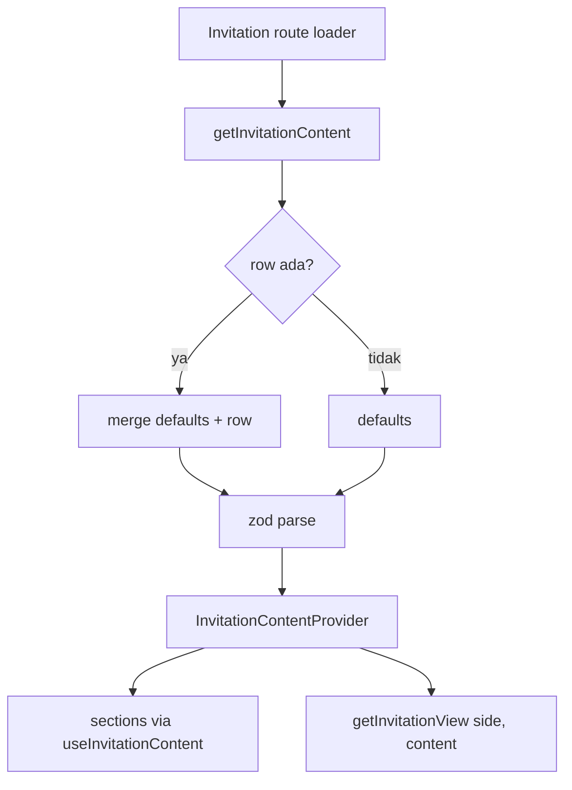
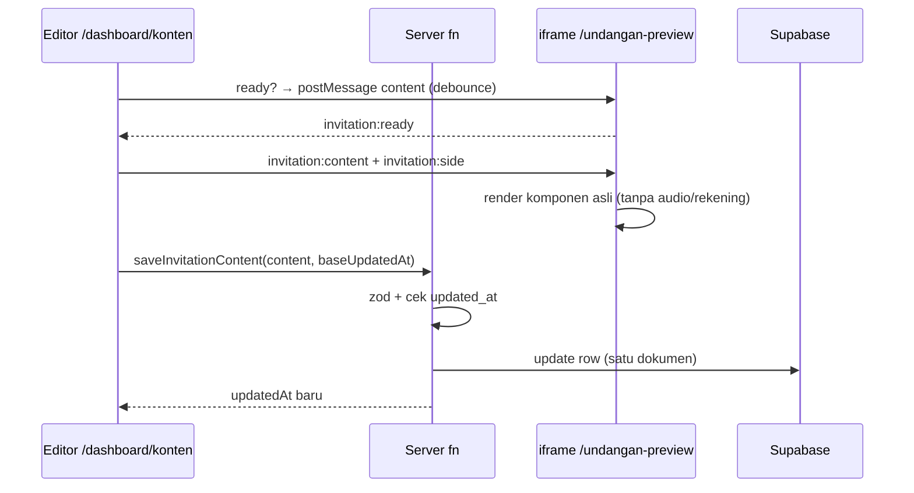

# Dashboard Konten, Musik, Photobooth & Wall — Spec

Dokumen ini adalah kontrak kerja. Requirement di bawah **immutable**: perubahan
harus lewat keputusan eksplisit, bukan diam-diam saat implementasi.

## Keputusan pemilik

| # | Pertanyaan | Keputusan |
|---|---|---|
| 1 | Cakupan konten fase pertama | **1A** — teks lengkap + acara + cerita + musik |
| 2 | Model penyimpanan | **2B** — simpan langsung tayang (tanpa draf/terbit terpisah) |
| 3 | Sumber musik | **3A** — upload audio ke Supabase Storage + tempel tautan YouTube |
| 4 | Kedalaman frame photobooth | **4C** — editor frame bebas (drag/resize), modul terpisah |
| 5 | Live preview | **5A** — iframe undangan asli, draf via `postMessage`, toggle sisi Anas/Mila |

Asumsi yang disetujui secara default:

- Manajemen wall = lihat + hapus kartu saja (tanpa pin/sembunyikan).
- Akses hanya lewat `dashboard_users` yang sudah ada; tidak ada role baru.
- Nomor rekening tetap server-only dan **tidak bisa** diedit dari dashboard.
- Upload gambar/foto/ornamen undangan **tidak** termasuk fase 1A; hanya audio
  (dan overlay frame di fase 4C).

## Requirements (IMMUTABLE)

### Sumber & pembacaan konten

- Satu sumber kebenaran runtime: tabel `invitation_content` (satu baris,
  `id = 1`) berisi **seluruh dokumen konten** yang boleh diedit, disimpan sebagai
  `jsonb`.
- `src/data/invitation.ts` tetap menjadi **default** dan sumber tipe. Saat tabel
  belum ada / kosong / gagal dibaca, aplikasi **wajib** tetap berjalan memakai
  default (tanpa error ke tamu).
- Pembacaan konten memakai deep-merge `default ← tersimpan`, lalu divalidasi
  schema. Field baru di default otomatis muncul pada konten lama.
- Undangan selalu membaca konten **terkini** (2B). Tidak ada konsep draf/terbit.
- `getInvitationView(side, content)` tetap menjadi satu-satunya tempat aturan
  personalisasi (urutan mempelai, tanggal per sisi, urutan rekening, intro acara).
- Komponen `src/components/invitation/**` **tidak boleh** mengimpor
  `data/invitation` setelah refactor; konten datang dari
  `InvitationContentProvider`/`useInvitationContent()`.

### Penyimpanan & validasi

- Simpan = tulis **satu dokumen penuh** secara atomik setelah lolos schema
  (zod). Tidak ada penulisan per-field.
- Penulisan dijaga sesi dashboard (`readDashboardUser`), memakai service key.
- **Optimistic concurrency**: klien mengirim `baseUpdatedAt`; server menolak
  (tanpa menulis) jika baris sudah berubah, dengan pesan yang bisa dibaca.
- Tanggal divalidasi sebagai `YYYY-MM-DD` yang benar; URL media divalidasi
  (https, host yang diizinkan untuk YouTube); panjang teks dibatasi schema.
- `updated_at` dan `updated_by` (email dashboard) diperbarui setiap simpan.

### Live preview

- Route preview khusus (contoh `/undangan-preview`) yang:
  - dijaga sesi dashboard, `noindex, nofollow`;
  - merender **komponen undangan asli** di dalam iframe;
  - menerima konten via `postMessage` dari editor (same-origin saja) dan
    langsung re-render tanpa menyimpan;
  - bisa toggle sisi `Anas` / `Mila` / `tanpa sisi`;
  - **tidak** memutar musik otomatis, **tidak** memanggil
    `getGiftAccountNumber`, **tidak** memanggil `markGuestOpened`, dan tidak
    membuka tautan photobooth keluar jendela.
- Editor mengirim konten (debounce ≤ 300 ms) dan menerima sinyal `ready` dari
  iframe; preview menampilkan perubahan yang belum disimpan.
- Di layar ≥ 1024 px preview sticky di kanan; di layar kecil preview tampil
  sebagai panel/tab terpisah.

### Musik

- Konten musik berbentuk objek: `{ enabled, url, title }`.
- `url` boleh berupa file audio yang di-upload atau tautan YouTube.
- Upload audio: server membuat **signed upload URL** setelah memvalidasi MIME
  (`audio/mpeg`, `audio/mp4`, `audio/ogg`, `audio/wav`) dan ukuran (≤ 15 MB);
  browser mengunggah langsung ke bucket `invitation-media`. Path acak
  (`music/<uuid>.<ext>`), bucket public-read **tanpa listing**.
- Player mendukung dua jenis sumber (pola `docs/references/music`):
  `UniversalAudioPlayer` (direct + YouTube) dan `MusicController` floating.
- Pemutaran dimulai setelah interaksi pertama pengguna (autoplay browser
  diblokir); YouTube API **hanya** dimuat saat musik aktif dan setelah
  interaksi. Loop aktif. Tombol memutar/menghentikan selalu tersedia setelah
  interaksi. Reduced-motion menonaktifkan animasi tombol.

### Photobooth

- Fase A (`/dashboard/photobooth`): edit copy kartu (`eyebrow`, `names`, `date`),
  `textColor` (satu warna untuk ketiga baris; default hitam), `downloadName`,
  `scale`; preview canvas memakai `drawComposition` dengan foto placeholder.
  Geometri layout ditampilkan read-only. Upload frame/background dan perubahan
  posisi yang sudah selesai (drag, resize, undo) disimpan otomatis setelah jeda
  singkat agar refresh tidak kehilangan gambar.
- Fase B (4C): editor frame bebas — drag/resize slot, tambah/hapus slot per
  layout (1/2/4), geser teks, atur background/radius, unggah overlay PNG
  opsional; perubahan tersimpan ke dokumen konten yang sama. Fase B punya spec
  sendiri (`docs/invitation/frame-editor.md`) dan dikerjakan setelah fase A.
- Perubahan photobooth tidak boleh merusak undangan: schema wajib memvalidasi
  jumlah slot (1/2/4), nilai positif, dan slot berada di dalam kanvas.

### Wall

- `/dashboard/wall`: daftar kartu (thumbnail, nama tamu, ucapan, audio, tanggal)
  dengan pagination, dan hapus kartu.
- Hapus dari dashboard menghapus row **dan** file Storage, dijaga sesi
  dashboard (tanpa token di URL).
- Mode lama `?admin=<token>` tetap berfungsi sebagai cadangan.

### Umum

- Semua akses DB lewat server function; service key tidak pernah ke browser.
- Dashboard `noindex, nofollow`.
- Tidak ada dependency baru jika fitur bisa dicapai dengan dependency yang ada
  (`zod`, `@supabase/supabase-js`, `lucide-react` sudah tersedia).

### Responsif

- Editor konten dan photobooth memakai action bar **fixed** di bawah layar berisi
  Reset dan Simpan; konten diberi padding bawah agar tidak tertutup.
- Di bawah `lg`, editor dan pratinjau dipisah dengan tab `Editor | Pratinjau`;
  kedua panel tetap ter-mount sehingga iframe/canvas tidak kehilangan state dan
  tetap menerima update draft.
- Navigasi dashboard bisa digeser horizontal di layar kecil (tanpa bottom tab
  bar).
- Daftar tamu: filter dilipat di balik tombol Tampilkan di bawah `lg`, dan kolom
  **Nama** sticky di kiri saat tabel digeser horizontal.

## Success Criteria

- [ ] Tanpa migrasi dijalankan, undangan tetap tampil normal memakai default.
- [ ] Setelah `0005` dijalankan, mengubah judul cover dari
      `/dashboard/konten` → Simpan → reload `/invitation/:slug` menampilkan
      judul baru.
- [ ] Preview kanan menampilkan perubahan **sebelum** disimpan dalam ≤ 300 ms.
- [ ] Toggle sisi di preview mengubah urutan mempelai, tanggal cover, dan
      urutan rekening sesuai aturan personalisasi yang sudah ada.
- [ ] Preview tidak pernah menampilkan nomor rekening dan tidak memutar audio.
- [ ] Upload MP3 berhasil lalu diputar di undangan setelah interaksi pertama;
      tautan YouTube juga diputar lewat player tersembunyi.
- [ ] Upload dengan MIME/ukuran salah ditolak dengan pesan jelas; tidak ada file
      tersimpan.
- [ ] Dua tab editor: tab dengan `baseUpdatedAt` lama ditolak dan tidak
      menimpa perubahan tab lain.
- [ ] `/dashboard/photobooth` mengubah copy kartu dan preview canvas ikut berubah;
      undangan/photobooth memakai copy baru. Mengubah warna teks kartu juga
      tercermin di preview dan hasil unduhan.
- [ ] Fase B: drag/resize slot tersimpan dan hasil unduhan mengikuti posisi baru.
- [ ] `/dashboard/wall` menghapus kartu + file Storage; mode token lama tetap
      berfungsi.
- [ ] Di viewport < 1024 px, editor dan pratinjau bisa ditukar lewat tab tanpa
      kehilangan isi form atau state pratinjau, dan tombol Reset/Simpan selalu
      terlihat.
- [ ] `pnpm lint`, `tsc --noEmit`, `pnpm test`, `pnpm build` hijau.

## Anti-Patterns (FORBIDDEN)

- ❌ **Menulis dokumen tanpa validasi schema** (alasan: satu field rusak membuat
  seluruh undangan gagal render).
- ❌ **Simpan per-field / beberapa request terpisah** (alasan: state parsial bisa
  tayang; harus satu dokumen atomik).
- ❌ **Menyimpan nomor rekening, nomor HP, atau secret di `invitation_content`**
  (alasan: dokumen dikirim ke browser tamu; nomor rekening tetap server-only).
- ❌ **Komponen undangan mengimpor `data/invitation` langsung** setelah refactor
  (alasan: perubahan dashboard tidak akan terlihat).
- ❌ **Preview memanggil `getGiftAccountNumber` / `markGuestOpened` / autoplay**
  (alasan: membocorkan nomor rekening, mengotori statistik tamu, dan mengganggu).
- ❌ **Autosave tanpa `baseUpdatedAt`** (alasan: lost update saat dua tab).
- ❌ **Memuat YouTube Iframe API saat halaman dibuka** (alasan: privasi &
  performa; muat hanya saat musik aktif dan setelah interaksi).
- ❌ **Route preview dapat diakses publik tanpa guard/noindex** (alasan: halaman
  internal dashboard).
- ❌ **Menerima upload tanpa validasi MIME/ukuran** atau membuat bucket dengan
  listing publik (alasan: penyalahgunaan storage).
- ❌ **Merender HTML mentah dari konten** (alasan: XSS; gunakan `RichText`).
- ❌ **Menghapus konten lama tanpa peringatan** saat reset (alasan: 2B tidak
  menyimpan riwayat; reset harus eksplisit dan dikonfirmasi).

## Arsitektur

### Skema data

`invitation_content`:

```sql
create table if not exists public.invitation_content (
  id smallint primary key default 1 check (id = 1),
  content jsonb not null,
  updated_at timestamptz not null default now(),
  updated_by text
);
alter table public.invitation_content enable row level security;
-- tanpa policy: hanya service key (server) yang boleh baca/tulis
```

`0006_invitation_media.sql` membuat bucket `invitation-media` (public read,
tanpa listing) beserta policy SELECT publik.

### Bentuk konten

```ts
{
  cover: { eyebrow, firstNames, secondNames, startDate, endDate,
           guestLabel, scrollLabel },            // aset gambar tetap dari default
  couple: { groom: {...}, bride: {...} },        // label, fullName, parents
  sections: { couple, event, story, photobooth, wall, gift, closing },
  events: [{ id, label, date, time?, schedules?, location }],
  sides: { groom: { eventIds }, bride: { eventIds } },
  story: [{ date?, title?, body? }],
  gifts: [{ method, bankName, side, accountHolder }], // tanpa nomor
  giftThanks,
  closing: { heading, body, label },
  music: { enabled, url, title },                // url = file | YouTube
  photobooth: { scale, downloadName, card: {...}, layouts: {...},
                frame?: { url, x, y, width } }   // frame = fase 4C
}
```

### File & modul

| File | Isi |
|---|---|
| `src/lib/invitation-content-schema.ts` | zod schema, `InvitationContent` type, `defaultContent` (dari data), `mergeContent`, `parseContent` |
| `src/lib/invitation-content.ts` | server fn: `getInvitationContent`, `getInvitationContentForDashboard`, `saveInvitationContent`, `resetInvitationContent`, upload music |
| `src/lib/invitation-upload.ts` | validasi MIME/ukuran + pembuatan path (fungsi murni, dites) |
| `src/components/invitation/InvitationContentProvider.tsx` | context + hook |
| `src/routes/dashboard.konten.tsx` | editor + live preview |
| `src/routes/undangan-preview.tsx` | iframe target, guard dashboard, noindex |
| `src/components/dashboard/content/*` | form per bagian |
| `src/routes/dashboard.photobooth.tsx` | copy + preview canvas |
| `src/routes/dashboard.wall.tsx` | daftar + hapus kartu |
| `src/components/invitation/audio/*` | player direct + YouTube, controller |
| `supabase/migrations/0005_invitation_content.sql` | tabel konten |
| `supabase/migrations/0006_invitation_media.sql` | bucket media + policy |

### Alur baca



### Alur edit & preview



### Upload musik

1. Editor memilih file → validasi klien (MIME/ukuran) untuk UX.
2. `createMusicUploadUrl({ fileName, mime, size })` (guarded) → validasi server,
   `storage.from('invitation-media').createSignedUploadUrl(path)`.
3. Browser `uploadToSignedUrl(path, token, file)`.
4. URL publik dimasukkan ke `content.music.url` dan disimpan.

## Modules / urutan build

| Modul | Tanggung jawab | Depends on |
|---|---|---|
| `content-store` | schema, merge, baca, simpan, reset, migrasi 0005 | — |
| `content-provider` | context + refactor 11 komponen | content-store |
| `content-editor` | form + preview iframe + upload musik | content-store, content-provider |
| `audio` | player direct/YouTube + controller | content-store |
| `photobooth-admin` | copy + preview canvas | content-store |
| `frame-editor` | drag/resize frame (spec terpisah) | photobooth-admin |
| `wall-admin` | daftar + hapus kartu | — |

Urutan: `content-store → content-provider → (content-editor, audio) →
photobooth-admin → frame-editor → wall-admin`.

## Tasks

### Task 1 — Content store (detailed)

Deliverable: dokumen konten tervalidasi bisa dibaca dan disimpan, tanpa
mengubah tampilan undangan.

- [x] `supabase/migrations/0005_invitation_content.sql` — tabel single-row,
      RLS aktif tanpa policy.
- [x] `src/lib/invitation-content-schema.ts`
      - `InvitationContent` type (widen literals dari default),
      - `invitationContentSchema` (zod) mencakup semua field di atas,
      - `defaultContent` hasil parse `data/invitation` (test: default valid),
      - `mergeContent(stored)` deep-merge default ← stored,
      - `parseContent(input)` → `{ ok, content } | { ok: false, error }`.
- [x] `src/lib/invitation-content.ts`
      - `getInvitationContent` (publik, fallback default saat tabel tidak ada),
      - `getInvitationContentForDashboard` (guarded, mengembalikan `updatedAt`),
      - `saveInvitationContent({ content, baseUpdatedAt })` (guarded, zod,
        concurrency, `updated_by`),
      - `resetInvitationContent({ baseUpdatedAt })` (guarded, tulis default).
- [x] `src/lib/invitation-upload.ts` — `MUSIC_MIME`, `MUSIC_MAX_BYTES`,
      `validateMusicUpload`, `musicObjectPath` (fungsi murni).
- [x] `src/lib/invitation-content.test.ts` — schema menolak tanggal salah,
      slot photobooth tidak valid, musik tanpa URL saat enabled; merge mengisi
      field baru; concurrency helper.
- [x] Verifikasi: `corepack pnpm@10.19.0 lint`, `tsc --noEmit`, `test`, `build`.

### Task 2 — Provider & refactor komponen

- [x] `InvitationContentProvider` + `useInvitationContent()`.
- [x] `getInvitationView(side, content)`; route undangan/wall/personalization
      memakai konten dari loader.
- [x] Ganti import `data/invitation` di `Cover`, `Couple`, `Event`, `Story`,
      `Photobooth`, `Gift`, `Closing`, `WallPage`, `PhotoboothPage`,
      `PhotoboothCapture`, `PhotoboothPreview`. (Import **tipe** seperti
      `InvitationEvent`/`InvitationGiftAccount` tetap boleh; yang dihapus adalah
      import nilai `invitation`.)
- [x] `src/lib/invitation-content-default.ts` — default bebas zod supaya bundle
      tamu tidak ikut memuat validator (zod hanya di chunk server).
- [x] Verifikasi SSR: `vite preview` + `GET /invitation/test` → HTTP 200 dan
      section (cover, mempelai, kisah, tanda kasih) tetap dirender.

### Task 3 — Editor konten + live preview

- [x] `/dashboard/konten` (layout 2 kolom), form per bagian, status simpan,
      guard perubahan belum disimpan.
- [x] `/undangan-preview` guarded + `postMessage` + toggle sisi.
- [x] Upload musik (bucket `invitation-media`, migrasi `0006`) + input YouTube +
      toggle aktif + judul.
- [ ] Navigasi dashboard: Konten, Photobooth, Wall. (Konten sudah; Photobooth dan
      Wall menyusul di Task 5/7.)

### Task 4 — Player musik

- [x] `audio-source.ts` — deteksi direct vs YouTube (watch, youtu.be, shorts,
      embed, music.youtube) + unit test.
- [x] `UniversalAudioPlayer` (direct + YouTube, loop, retry gesture, API YouTube
      hanya dimuat setelah interaksi).
- [x] `MusicController` (floating, reduced-motion aware, aria-pressed).
- [x] Integrasi ke halaman undangan; controller muncul setelah gestur pertama.
- [ ] Verifikasi dengar langsung di browser/HP setelah URL musik diisi.

### Task 5 — Photobooth admin (copy + preview)

- [x] `/dashboard/photobooth`: copy kartu, `downloadName`, `scale`, preview
      canvas dengan placeholder, geometri read-only.
- [x] Validasi schema slot (1/2/4) sudah berjalan di content-store.
- [x] `useContentDraft` — hook simpan/concurrency bersama untuk halaman Konten
      dan Photobooth.
- [x] Verifikasi: `/invitation/test/photobooth` `200`; dashboard tanpa sesi
      `307`; dengan sesi `200` dan canvas pratinjau dirender.

### Task 6 — Frame editor (4C)

- [ ] Tulis `docs/invitation/frame-editor.md` lebih dulu (drag/resize, snapping,
      add/remove slot, overlay PNG, undo/redo).
- [ ] Implementasi editor + persist ke `content.photobooth`.
- [ ] `drawComposition` mendukung overlay frame.

### Task 7 — Wall admin

- [x] `listWallCardsPage` (guarded, pagination, signed URLs) +
      `deleteWallCardAsDashboard`.
- [x] `/dashboard/wall` grid + dialog hapus + pemutar audio native + tombol
      “Muat lagi”.
- [x] `WallDeleteDialog` digeneralisasi (`deleteCard` callback) sehingga wall
      publik tetap memakai token dan dashboard memakai sesi.
- [x] Verifikasi: wall publik `200`, dashboard tanpa sesi `307` ke login,
      dashboard dengan sesi `200` dan kartu (termasuk audio) dirender.

## Setup manual

1. Jalankan `supabase/migrations/0005_invitation_content.sql`,
   `0006_invitation_media.sql`, `0007_invitation_frames.sql`, dan
   `0008_invitation_frames_jpeg.sql` di SQL Editor.
2. Pastikan env server tetap: `SUPABASE_URL`, `SUPABASE_SECRET_KEY`,
   `SUPABASE_PUBLISHABLE_KEY`, `DASHBOARD_SESSION_SECRET`.
3. Restart dev server setelah migrasi dan perubahan server function.
4. Backfill opsional: `insert into invitation_content (id, content) values (1, '{}'::jsonb);`
   (kosong = default dipakai).

## Open Questions

- Batas panjang tiap field teks: diputuskan di schema (cover/section 120 char,
  body 1200 char) — bisa disesuaikan saat review.
- Apakah editor perlu tombol "Reset ke default" per bagian atau hanya global
  (default: global dengan konfirmasi).
- Frame editor: perlu undo/redo penuh atau cukup reset per layout (diputuskan di
  spec fase B).
- Apakah `scale` photobooth diekspos sebagai angka bebas (1–4) atau preset
  (1x/2x/3x) — default: preset.
